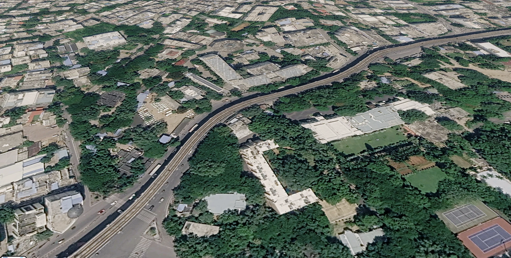

# Hyderabad Metro — Blue Line Live Tracker

A real-time 3D tracker for the Hyderabad Metro Blue Line (Corridor II). The train
runs the actual Nagole ↔ Raidurg alignment on a procedural elevated viaduct,
drawn over live satellite imagery with extruded buildings. The camera is locked
to the set, follows the track, and can be orbited with the mouse.

No API keys, tokens or paid map services are required.



## Run it

The app is a static site. Any local web server works:

```bash
python3 -m http.server 4399
# open http://localhost:4399/index.html
```

A server is required (the route data and ES modules are fetched over HTTP; the
browser blocks `file://` module loading).

## Controls

| Input | Action |
| --- | --- |
| Drag | Orbit the camera (bearing / pitch) |
| Wheel / pinch | Zoom |
| Double-click | Recentre the chase camera |
| `Space` | Pause / resume the simulation |
| `1` `2` `3` | 0.5× / 1× / 2× simulation rate |
| `R` | Recentre camera |
| `H` | Hide / show the HUD |
| `B` | Toggle 3D buildings |
| `I` | About panel |

## What is simulated

- 23 stations, 27.2 km, real station order and spacing from OpenStreetMap.
- Acceleration, line-speed cruise, braking and a stop at every station.
- Door opening / dwell / closing, with a longer layover at the termini.
- Direction reversal at Nagole and Raidurg; destination blinds and head / tail
  lights switch ends with the direction.
- Live tracker HUD: next station, arrival ETA, distance to go, segment progress,
  upcoming stations, speed, longitudinal acceleration, lateral g, curve radius,
  grade, traction, door state, load, delay and odometer.
- 3-car D–M–D set with four doors per side per car, glazed panels between the
  doors, identical cab ends, brushed-steel body, blue cantrail, blue cab with the
  HMR red / green / blue stripe motif, roof AC units and a single-arm pantograph.
- Elevated guideway with a centre walkway, cable troughs, parapet panel joints,
  catenary masts and contact wires; platforms with granite paving, tactile
  strips, ribbed canopies, blue fascias and hanging name boards.

## Map stack (all free, keyless)

- **MapLibre GL JS 4.7.1** — map renderer, vendored in `vendor/`.
- **Esri World Imagery** — satellite raster tiles
  (`server.arcgisonline.com/.../World_Imagery`). Attribution is shown in the
  footer.
- **OpenFreeMap** — vector tiles (`tiles.openfreemap.org/planet`) for the
  extruded 3D buildings. Attribution shown in the footer.
- **OpenStreetMap** — Blue Line relation `8297688`, saved as
  `assets/data/blue-line.json` with 513 nodes and 23 stations.

The train and viaduct are authored in a local metric frame and projected into
MapLibre's Mercator space per frame with `transform.customLayerMatrix()`, so the
set stays glued to the real corridor at street zoom.

## Structure

```
index.html              tracker UI, intro, attribution
css/style.css           glass HUD, journey card, telemetry, responsive layout
js/config.js            line, map, viaduct, train and simulation constants
js/geo.js               OSM route loading, Mercator projection, resampling
js/viaduct.js           deck, parapets, rails, piers, catenary, stations
js/train.js             procedural 3-car set, doors, cabs, destination blinds
js/world.js             MapLibre style, custom Three.js layer, sun / sky
js/main.js              simulation, placement, chase camera, HUD, controls
assets/data/blue-line.json   route geometry + station chainage
vendor/                 Three.js r170, RoundedBoxGeometry, MapLibre GL JS
```

## Debug URL parameters

Useful while tuning (all optional):

- `?station=Habsiguda` — start dwelling at a named or zero-based station.
- `?km=17.05` — start mid-section at a chainage in kilometres.
- `?hold=1` — hold at the selected station with the doors open (UI test).
- `?zoom=20.15&pitch=50&look=16` — override the chase camera.
- `?raf=1` — run the animation loop on a timer instead of `requestAnimationFrame`
  (for headless / background-tab capture).

## Notes

- The route and station chainage come from OpenStreetMap; the guideway,
  stations and train are an independent visual reconstruction, not an
  operational feed.
- The three.js scene is rendered into MapLibre's WebGL context, so there is no
  second canvas or DOM overlay to keep in sync.
- Satellite imagery © Esri, Maxar, Earthstar Geographics. Map data ©
  OpenStreetMap contributors. Vector tiles © OpenFreeMap.
