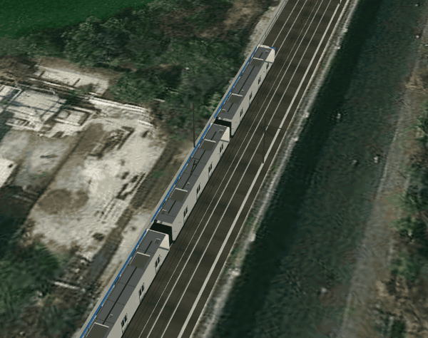
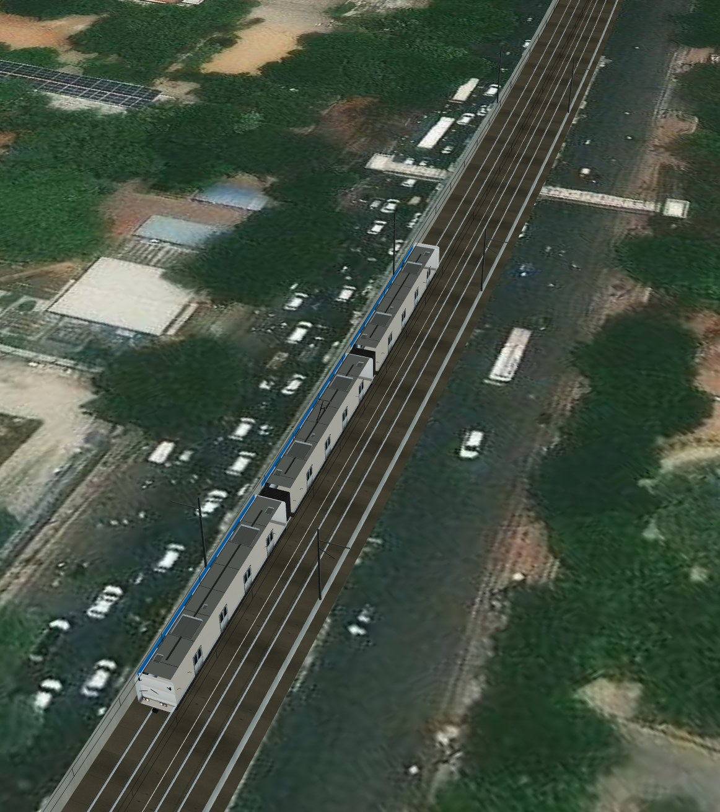
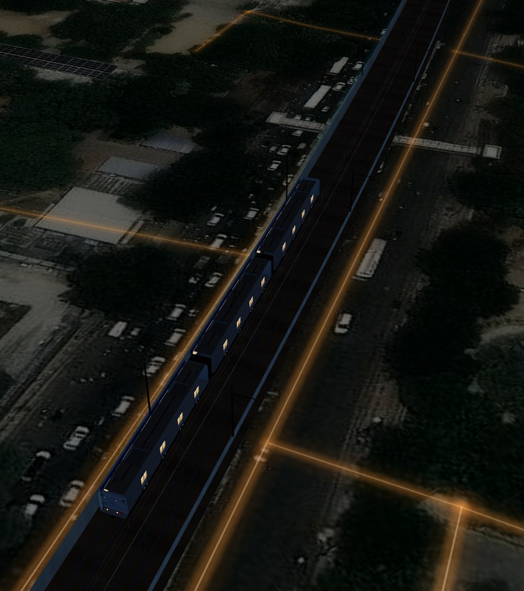
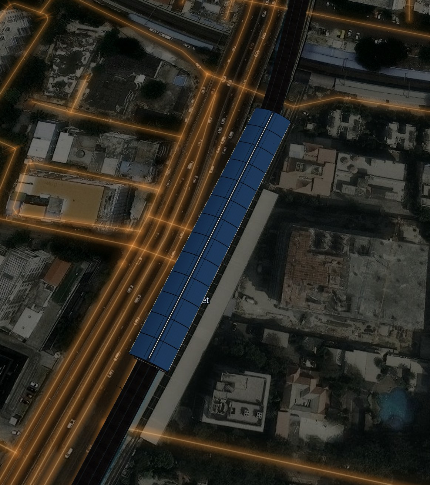
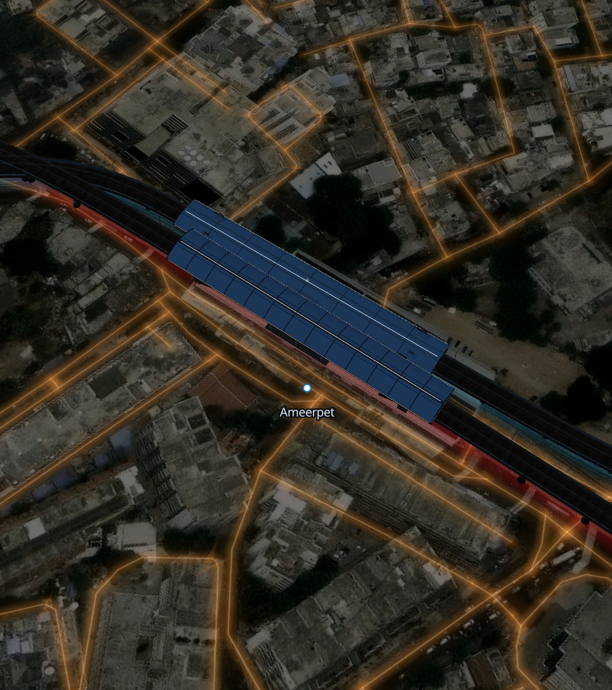
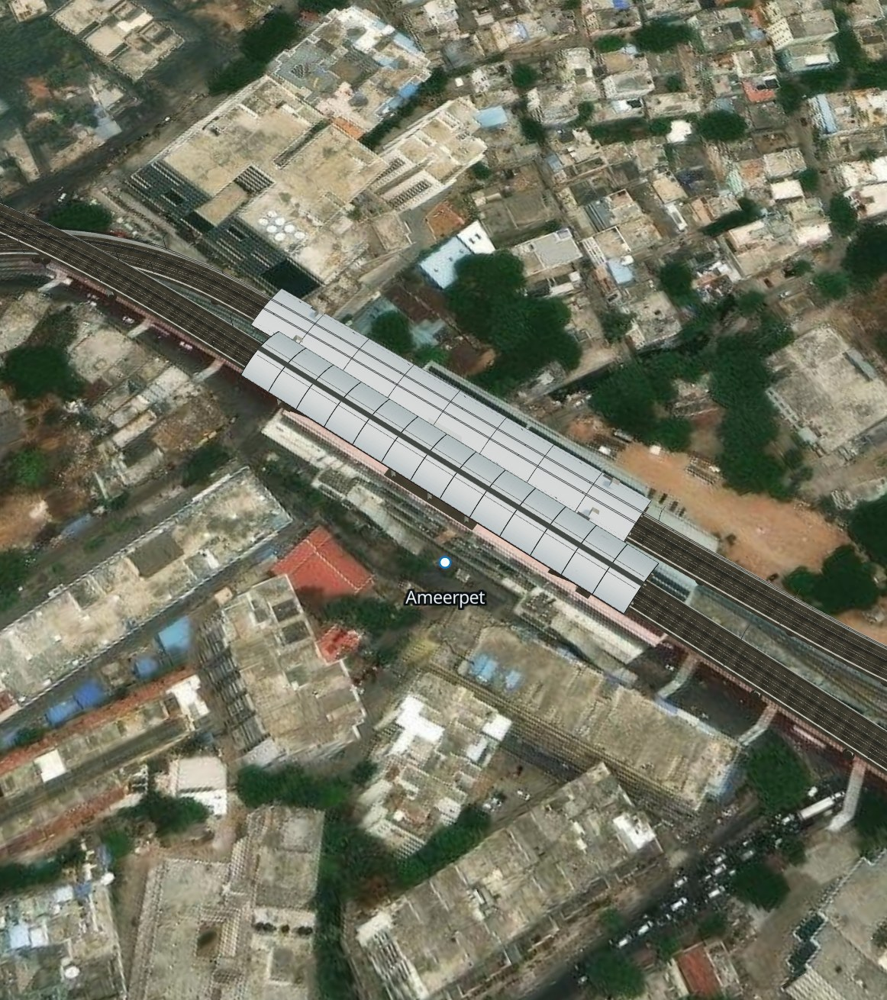

# Metro Live

### A real-time 3D tracker for the entire Hyderabad Metro network.

<p>
<a href="https://abhinav-prabhakar.github.io/ProjectMetro/"></a>


</p>

**Red · Green · Blue — 64.6 km, 57 stations, 57 three-car sets**, all driven by the
official HMRL timetable. Every set in service is simulated; the camera rides one
of them along a photo-real elevated viaduct, over live satellite imagery, with a
city that switches on when the sun goes down.

<br>

*Between Stadium and NGRI — the Blue Line, live.*



<br>

## Day / night

| Golden hour | After dark |
| --- | --- |
|  |  |

The whole scene relights: warm sodium street-light bloom across the city grid,
lit train windows, illuminated canopies, headlights, and a sky that changes with
the time mode. The switch is one slow (~5 s) crossfade — the 3D light rig, the
sky gradient, the satellite grade, the OSM street glow and the train lamps all
move together, so the city never snaps from noon to midnight.

## Stations & interchanges

| Station, night | Ameerpet interchange |
| --- | --- |
|  |  |

Interchanges are modelled as one complex: the upper corridor's hall, the lower
corridor's hall and the glazed concourse that joins them.



## What's actually going on

- **Real timetable.** The official HMRL GTFS feed is compiled into a network
  graph — 2,820 trips across weekday, Saturday and Sunday service (1,062 on a
  weekday), 61,236 stop times, 706 stops, 6 shapes. A service-day clock runs on
  IST, so what you see matches the published schedule.
- **The whole network.** The dock counts every set in service across all three
  corridors, and the fleet board lists all of them. The renderer still only
  draws the sets near the camera — the timetable is global, the draw call is
  local.
- **57 sets, 70 weekday duties.** The feed's weekday timetable has 70 duty
  blocks; the HMRL fleet is 57 three-car sets, and peak concurrency is 56.
  Blocks are duties, not a fleet count — summing the three service classes
  gives 162, which is why that number should never be read as "trains".
- **Real physics.** Trains accelerate at `0.95 m/s²`, brake at `1.05 m/s²`, and
  cruise at up to 80 km/h. Each segment's cruise speed is solved so the arrival
  time matches GTFS exactly.
- **Real turnbacks.** A set that reaches a terminus waits, reverses and moves
  onto the opposite track before its next trip — consecutive trips in the feed
  are linked into blocks, which is what a train set actually does all day.
- **Only what you can see.** Every train is simulated, but only the sets near the
  camera are drawn — the followed one in full detail, the rest as light proxies.
- **Data-driven.** Nothing about Hyderabad is hard-coded in the renderer. Point
  the compiler at another GTFS feed and the same engine draws that city.

## Run it

Static site — no build step, no keys, no paid tiles.

```bash
python3 -m http.server 4399
open http://localhost:4399/index.html
```

A local server is required (ES modules and the compiled network are fetched over
HTTP; `file://` will not work).

Rebuild the network from a GTFS feed:

```bash
node tools/build-network.mjs     # writes assets/data/network.json
```

Regenerate every brand asset (favicons, PWA/maskable icons, shortcut icons,
Apple splash screens, OG/Twitter cards, manifest screenshots):

```bash
python3 tools/make-icons.py      # writes assets/icons/
```

## Install it

The tracker is a full PWA — open it in any modern browser and install it from
the address bar, the browser menu, or the download icon in the header. On iOS,
use **Share → Add to Home Screen**; the app shows that path automatically after
the first few seconds. Installed, it runs standalone (no browser chrome), owns
the display safe areas, and gets line-specific home-screen shortcuts for Red,
Green and Blue.

The manifest declares an absolute identity so the app can never collide with
another installed PWA:

```json
{ "id": "/ProjectMetro/", "scope": "/ProjectMetro/",
  "start_url": "/ProjectMetro/?source=pwa" }
```

**Offline:** `sw.js` precaches the app shell, fonts and the compiled network.
Navigations, code and data are network-first, so an online load always gets the
current build and timetable; when the connection drops, the last cached shell
and timetable keep running, imagery pauses, and a status banner says so. A new
deployment triggers a quiet "new build ready" toast rather than swapping code
under a running session. Map tiles are deliberately not cached — they are
cross-origin and change constantly.

## Controls

| Input | Action |
| --- | --- |
| Drag | Orbit |
| Wheel / pinch | Zoom |
| Double-click | Recentre the chase camera |
| `Space` | Pause / resume (stays locked to the timetable) |
| Train pill | Pick any set in service — nearest first, with direction and live speed |
| `N` | Day / night |
| `L` | Cycle lines |
| `B` | Toggle 3D buildings |
| `R` | Recentre |
| `H` | Hide HUD |
| `I` | About |

There is deliberately no speed control. The clock is IST wall-clock time,
re-anchored to `Date.now()` every few seconds, so pausing and resuming always
puts every set exactly where the published timetable says it is. Drift and
dropped frames are absorbed by re-reading the wall clock rather than by
accumulating a delta.

## Under the hood

```
tools/build-network.mjs   GTFS  →  assets/data/network.json
js/network.js             projection, resampling, chainage, interchange levels
js/sim.js                 service day, trip solver, blocks, turnbacks, fleet
js/infrastructure.js      U-girder viaduct, track slabs, piers, OCS masts
js/station.js             canopy halls, platforms, signage, night lighting
js/train.js               procedural 3-car set, livery, doors, cabs, lighting
js/world.js               MapLibre ⇄ Three bridge, sky, night city layers
js/main.js                camera, placement, culling, HUD, controls
```

MapLibre renders the satellite raster and the OSM street graph; the metro lives
in a Three.js custom layer sharing MapLibre's WebGL context. Geometry is authored
in a local metric frame (x east, y up, z north) and the Mercator transform is
folded into the projection matrix, so a single draw call places the whole network
anywhere on the planet without losing float precision.

## Data & credits

- Timetable and station data: **Hyderabad Metro Rail Ltd** via
  [Open Data Telangana](https://data.telangana.gov.in/) (GTFS, 2026).
- The bundled feed in `tools/gtfs/` is byte-identical to the published
  `telangana_opendata_gtfs_hmrl_03_july_2026.zip`. Its six shapes total 64.6 km;
  HMRL publishes 69.2 km of operational route, the extra length being terminal
  and depot track that the feed's shapes do not carry.
- Imagery: **Esri World Imagery** via the public ArcGIS tile service.
- Streets and buildings: **OpenStreetMap** contributors, vector tiles by
  **OpenFreeMap**.
- Rendering: **Three.js**, **MapLibre GL JS**.

Not affiliated with HMRL. Built as a visualisation of public timetable data.

## License

MIT
